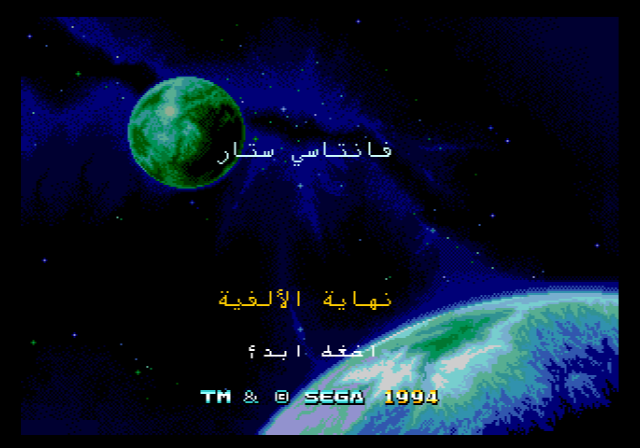
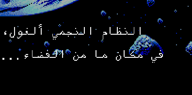
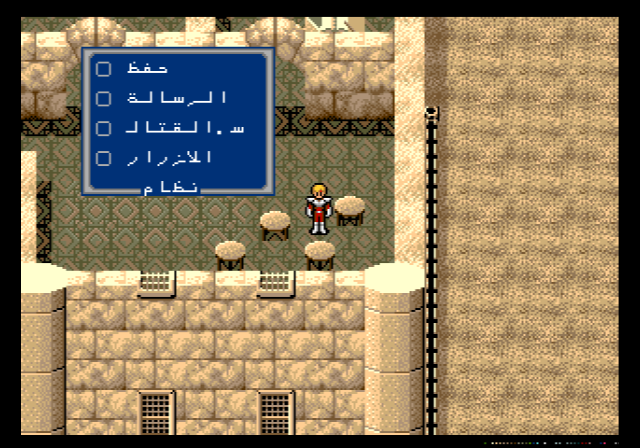
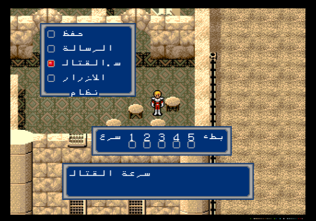

# Phantasy Star IV — Arabic Localization (تعريب فانتاسي ستار 4)

تعريب عربي متكامل وهندسة عكسية للعبة **Phantasy Star IV: The End of the Millennium** لجهاز **Sega Genesis / Mega Drive**، يتضمن ترجمة كاملة للحوارات (9,905 سطر)، خط حوار عربي 8×16 واضح بدقة 1 بكسل، خط قوائم 8×8 مصمّم يدوياً بخط أساس موحّد، شاشة بداية معرّبة بخلفية شفافة، ورقعة **BPS** قانونية جاهزة للتطبيق.

Comprehensive Arabic fan translation, custom 8×16 dialogue and 8×8 pixel menu font pipelines, transparent Arabic title screen graphics, RTL shaping & encoding tools, and a legal **BPS** delta patch for *Phantasy Star IV: The End of the Millennium* (Sega Genesis / Mega Drive).

---

## 📸 معاينات حية من داخل اللعبة / Live In-Game Screenshots

| شاشة البداية (Title Screen) | الحوار العربي (Arabic Dialogue) |
|:---:|:---:|
| <br><sub>**شاشة العنوان:** فانتاسي ستار — نهاية الألفية — اضغط ابدأ بخط 1px وخلفية شفافة</sub> | <br><sub>**حوار المقدمة:** النظام النجمي ألغول، في مكان ما من الفضاء... (خط 8×16 واضح)</sub> |

| قائمة النظام Start (System Menu) | إعدادات الأزرار (Buttons Config) |
|:---:|:---:|
| <br><sub>**قائمة Start:** حفظ / الرسالة / س.القتال / الازرار / نظام بخط 8×8 متّزن</sub> | <br><sub>**إعدادات الأزرار:** جدول الأزرار بالكامل بخط 1px متناسق ومقروء</sub> |

---

## 🌟 مميزات المشروع / Project Highlights

1. **ترجمة كاملة للحوارات والنصوص (Full Arabic Translation):**
   - كتالوج ترجمة كامل يضم **9,905 سطر حوار** ([encoding/script_ar_full.tsv](encoding/script_ar_full.tsv)) خالٍ من أخطاء الترميز (`0 mojibake`).
   - تعريب شاشة البداية، قائمة Start/النظام، قوائم التخييم (أدوات، تقنية، مهارة، عتاد، حالة، تحدث، تمتمة، ماكرو)، الحفظ، وسرعات الرسائل والقتال.
2. **خطوط بكسل عربية مخصصة (Custom Pixel Fonts):**
   - **خط الحوار (8×16):** خط عربي دقيق بسُمك 1 بكسل متكامل مع محرك تشكيل وربط الحروف (RTL Shaping).
   - **خط القوائم (8×8):** 59 شكلاً عربياً مرسوماً يدوياً بسُمك 1 بكسل وخط اتصال أفقي موحّد (`y=5`) لضمان المحاذاة التامة والوضوح العالي داخل جميع النوافذ.
3. **توسيع الروم بأمان (4 MB Expanded ROM Architecture):**
   - توسيع الروم من 3 ميجابايت إلى 4 ميجابايت مع تحديث ترويسة سيجا وفحص التكامل الآلي (`0` أخطاء تجميع، `0` عدم تطابق جليفات).

---

## 🎯 التحقق من الروم الأصلي وتطبيق الباتش / Patching Guide

الرقعة المرفقة متوفرة بصيغة **BPS (Beat Patch System)** وتحتوي حصراً على فروقات بايتات ثنائية دون أي ملفات محمية بحقوق النشر.

### 1. بيانات الروم الأصلي النظيف (USA Base ROM):
- **الملف:** `Phantasy Star IV (USA).md` (أو `.bin` / `.gen`)
- **الحجم:** `3,145,728` بايت (3.0 MB)
- **SHA-1:** `BC7FF6D6A8408F38562BC610F24645CAD6C42629`
- **CRC-32:** `FE236442`

### 2. طريقة تطبيق الباتش:
1. استخدم برنامج **Floating IPS (FLIPS)** أو **Rom Patcher JS** (في المتصفح).
2. اختر الروم الأصلي النظيف `Phantasy Star IV (USA).md`.
3. طبّق الباتش: [patches/ps4-arabic-expanded.bps](patches/ps4-arabic-expanded.bps) (أو حمّله من صفحة [Releases](../../releases)).
4. سينتج الروم المعرّب النهائي:
   - **الحجم:** `4,194,304` بايت (4.0 MB)
   - **SHA-1:** `B91ED3BB04507AB31F3F352B59FF5267F74864D4`
   - **CRC-32:** `00E8361D`

---

## 🛠️ هيكلية المستودع / Repository Layout

```text
phantasy-star-iv-arabic/
├── docs/                 # التوثيق الفني (الجداول، الخطوط، المسرد، مسار العمل)
├── encoding/             # كتالوج الترجمة الكامل (9,905 سطر TSV) وجدول الترميز (.tbl)
├── font/                 # خط الحوار العربي 8×16 الثنائي ومعاينة الخط
├── patches/              # رقعة BPS النهائية المتحقّق منها (ps4-arabic-expanded.bps)
├── previews/             # لقطات شاشة حية من داخل المحاكي (Sandbox)
├── tools/                # أدوات التشكيل والترميز، مولّدات الخطوط، وبناء شاشة العنوان والتدقيق
├── .gitignore
├── LICENSE               # ترخيص MIT للمشروع
├── README.md
└── requirements.txt      # متطلبات بايثون
```

---

## ⚖️ إخلاء مسؤولية قانوني / Legal Disclaimer

هذا المشروع عبارة عن عمل تعريب غير تجاري ومفتوح المصدر موجّه لهواة ومجتمع ألعاب الريترو.
**المستودع لا يحتوي على أي ملفات ROM أو كود أصلي أو مواد صوتية وبصرية محمية بحقوق النشر.**
جميع الحقوق والعلامات التجارية للعبة *Phantasy Star IV* مملوكة لشركة **SEGA Corporation**. لاستخدام الباتش يجب أن تمتلك نسختك القانونية الأصلية من اللعبة.

---

## 📜 الترخيص / License

جميع الأدوات البرمجية، السكربتات، وملفات الترجمة والخطوط المخصّصة المنشأة في هذا المستودع مرخصة تحت ترخيص **MIT License**.
